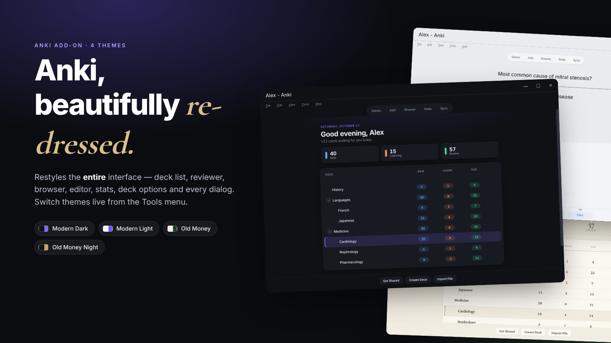
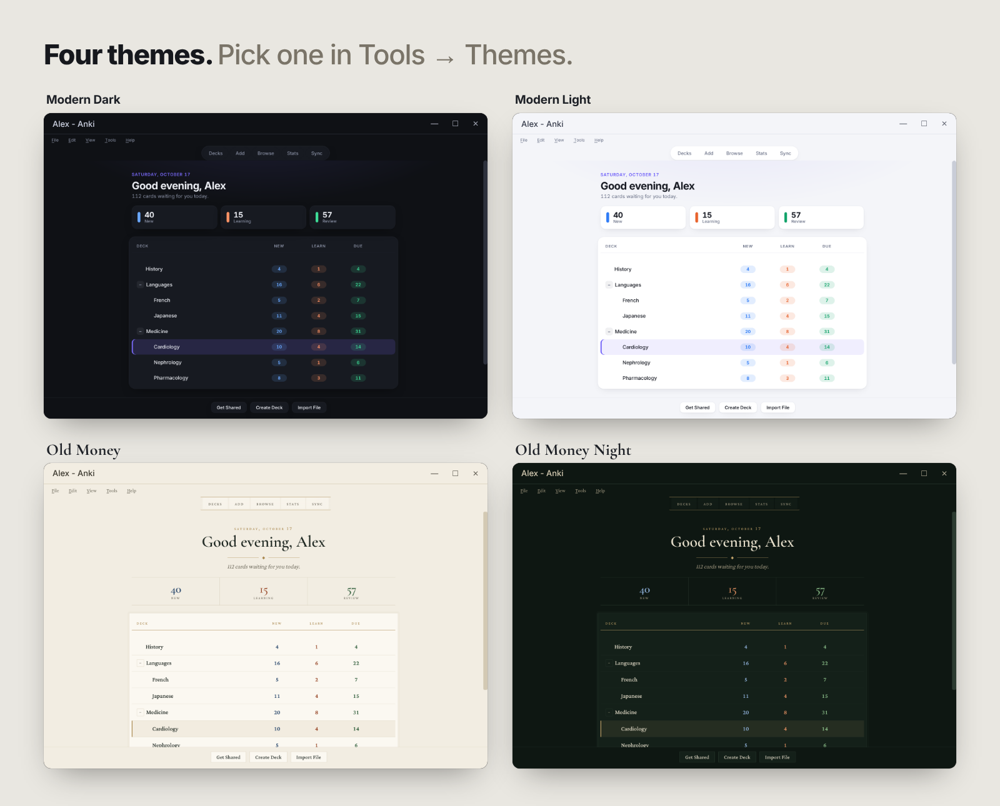
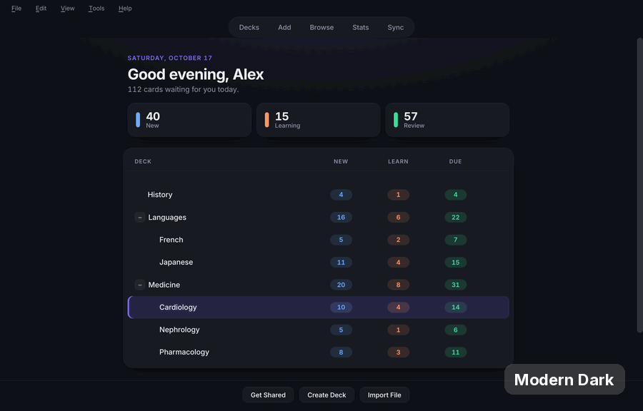
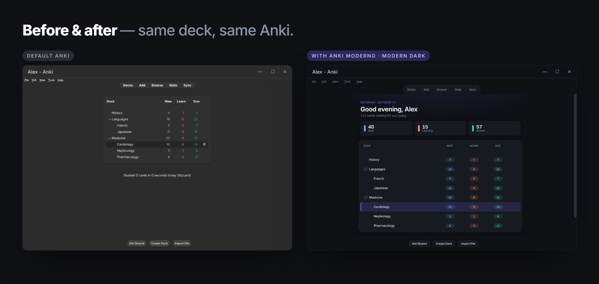

# Anki Moderno — Themes for the whole Anki interface



**Anki Moderno** restyles the *entire* Anki interface — deck list, reviewer, browser, card editor, statistics, deck options, menus and every dialog — with four themes you can switch live from **Tools → Themes**.

| Theme | Look |
|---|---|
| **Modern Dark** | Deep graphite, violet accent |
| **Modern Light** | Clean and bright |
| **Old Money** | Ivory paper, racing green, gold rules, classic serifs |
| **Old Money Night** | Dark green leather, brass details |





## Install

- **From AnkiWeb:** Tools → Add-ons → Get Add-ons… → paste the code `CÓDIGO_DO_ANKIWEB`.
- **From a file:** download `Anki_Moderno_v1.0.0.ankiaddon` from [Releases](../../releases) and double-click it (or Tools → Add-ons → Install from file…).

Restart Anki, then open **Tools → Themes**.

## Features

- Daily greeting with a New / Learning / Review summary above the deck list
- Restyled toolbar, overview, "Study Now", "Show Answer" and colored answer buttons
- Browser, Add/Edit editor, statistics, deck options, Preferences and all dialogs
- Native Qt widgets: menus, buttons, inputs, tables, tabs, scrollbars, tooltips
- Bundled fonts (Inter, Cormorant Garamond, Crimson Pro)
- Windows 11 title bars follow the theme
- English and Portuguese interface text (follows Anki's language)
- **Your note types are never modified**

## Configuration

Tools → Add-ons → Anki Moderno → Config

| Key | Default | Meaning |
|---|---|---|
| `tema` | `"moderno_escuro"` | `moderno_escuro`, `moderno_claro`, `old_money`, `old_money_noite` |
| `cor_destaque` | `""` | Empty = theme accent. Any hex (e.g. `"#3b82f6"`) overrides it |
| `mostrar_saudacao` | `true` | Greeting above the deck list |
| `barra_de_titulo_colorida` | `true` | Colored title bars on Windows 11 |

## Compatibility

Anki **24.06 or newer** (tested on 24.06.3, 25.02.7 and 26.9.3).

## How it works

The add-on recolors Anki's central color table (`_aqt.colors`), appends a Qt stylesheet through `style_did_init`, and injects the same palette and a stylesheet into every web view (`webview_will_set_content` and `webview_did_inject_style_into_page`). Card content is excluded.

## Development

```
src/            # add-on source (this is what goes into the .ankiaddon)
images/         # screenshots used on AnkiWeb and here
ankiweb/        # description used on the AnkiWeb add-on page
```

Build the package (from the repository root):

```bash
cd src && zip -r ../Anki_Moderno_v1.0.0.ankiaddon . -x "*__pycache__*" -x "meta.json"
```

## License

Code: MIT. Bundled fonts: SIL Open Font License 1.1 (license files included next to the fonts).

---

### 🇧🇷 Português

O **Anki Moderno** redesenha a interface inteira do Anki com quatro temas (Moderno Escuro, Moderno Claro, Old Money e Old Money Noite). Troque em **Ferramentas → Temas**, sem reiniciar. O visual dos seus cartões não é alterado. Funciona no Anki 24.06 ou mais novo.
